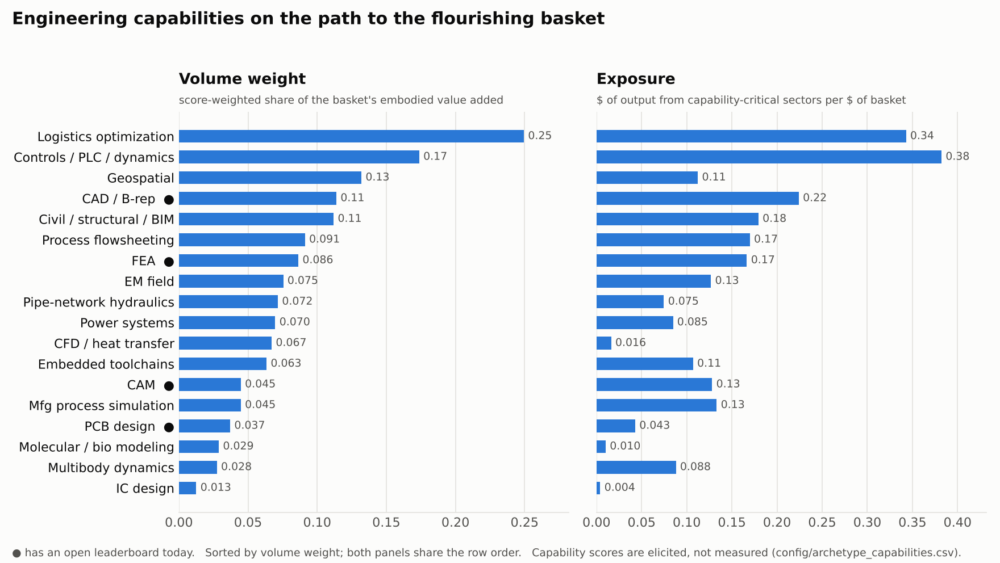
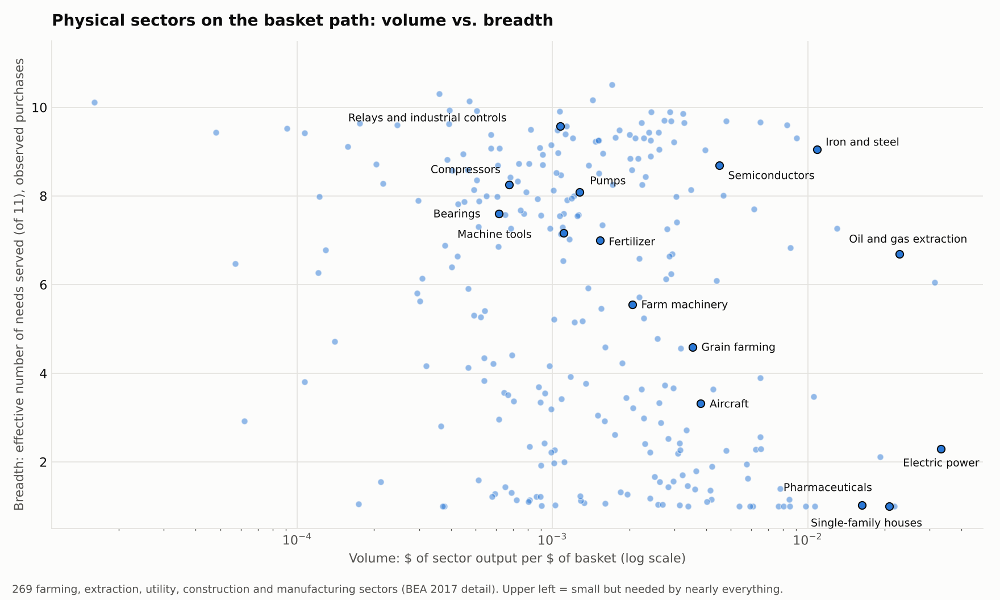

# plenty

Planning in the open for the machines behind human needs: **collect needs, collect current
capabilities, identify gaps, dispatch work.**

What is here so far is the first step of "identify gaps": a quantitative pass at which
engineering capabilities sit on the critical path to the things people need, and how heavily.

The method is input-output analysis. Define a basket of needs (food, shelter, health, and so
on), trace everything the economy must produce to deliver it, including the machines and
buildings used up along the way, and then ask which engineering-computation capabilities
(CAD, FEA, controls, process simulation, ...) those producing sectors depend on.

> **Status: first pass, 2026-11-24.** The input-output arithmetic is checked against BEA's
> own accounts. The three judgment layers on top of it (what counts as a need, who buys
> which capital goods, and how much each kind of sector depends on each capability) were
> written by an AI model in one sitting and have not been reviewed by domain experts. They
> live in `config/` as plain CSVs so they can be argued with and changed.

## Results

| capability | volume weight | exposure | volume rank | exposure rank | open board today |
|---|---|---|---|---|---|
| Logistics optimization | 0.249 | 0.343 | 1 | 2 | |
| Controls / PLC / dynamic simulation | 0.174 | 0.382 | 2 | 1 | |
| Geospatial | 0.132 | 0.112 | 3 | 10 | |
| CAD / B-rep | 0.114 | 0.224 | 4 | 3 | yes |
| Civil / structural / BIM | 0.112 | 0.179 | 5 | 4 | |
| Process flowsheeting | 0.091 | 0.170 | 6 | 5 | |
| FEA | 0.086 | 0.167 | 7 | 6 | yes |
| EM field | 0.075 | 0.127 | 8 | 9 | |
| Pipe-network hydraulics | 0.072 | 0.075 | 9 | 14 | |
| Power systems | 0.070 | 0.085 | 10 | 13 | |
| CFD / heat transfer | 0.067 | 0.016 | 11 | 16 | |
| Embedded toolchains | 0.063 | 0.107 | 12 | 11 | |
| CAM | 0.045 | 0.128 | 13 | 8 | yes |
| Manufacturing process simulation | 0.045 | 0.133 | 14 | 7 | |
| PCB design | 0.037 | 0.043 | 15 | 15 | yes |
| Molecular / bio modeling | 0.029 | 0.010 | 16 | 17 | |
| Multibody dynamics | 0.028 | 0.088 | 17 | 12 | |
| IC design | 0.013 | 0.004 | 18 | 18 | |

*Volume weight*: score-weighted share of the basket's embodied value added that arises in
sectors depending on the capability (each need counted equally). *Exposure*: dollars of
output from sectors that cannot operate without the capability, per dollar of basket.
Full tables, per-need breakdowns and sector lists are in [`results/summary.md`](results/summary.md).

What the numbers say:

1. **The basket is mostly services.** It is $13.0 trillion of 2017 US household and
   government consumption. Farming, extraction, utilities, construction and manufacturing
   carry 24% of the value added embodied in it.
2. **Machines only show up once capital is counted as an input.** A standard input-output
   table treats equipment and buildings as final demand, so a tractor is not an input to
   farming. Routing investment back to the industries that use it multiplies the basket's
   requirement for machinery by 6.5, construction by 7.0 and aerospace by 14.
3. **Controls and logistics lead on both measures.** After them comes a cluster of CAD,
   civil/structural, process flowsheeting and FEA, in that order on both measures.
4. **Geospatial is the one unstable result.** It ranks 3rd by volume and 10th by exposure,
   because its volume comes from low scores on very large service sectors.
5. **CAM and manufacturing process simulation rank low by volume (13th, 14th) but mid-table
   by exposure (8th, 7th).** Many sectors cannot run without them, and each is small.
6. **IC design ranks last on both measures, and that is a limit of the method.**
   Semiconductors reach 100% of the basket at 0.1 cents per dollar, but they are a small
   share of cost. Nothing in an input-output table says that a missing chip stops a car line.

Against the existing leaderboards: CAD (4th/3rd), FEA (7th/6th), CAM (13th/8th), PCB
(15th/15th). The largest uncovered capabilities by this measure are controls, logistics,
civil/structural and process flowsheeting.

The sectors that are small in cost but sold to nearly every need are a recognizable
industrial commons: nonferrous rolling and alloying, cutting tools and machine-tool
accessories, stampings, wiring devices, relays and industrial controls, steel products,
hardware, adhesives, motors and generators
([`results/bottleneck_candidates.csv`](results/bottleneck_candidates.csv)).

## Method

**1. Tables.** BEA 2017 benchmark Make (V) and Use (U) tables, 402 industries by 402
commodities, after redefinitions, producer prices.

**2. Capital as an input.** Investment by commodity (private equipment, structures,
intellectual property, residential, and government investment) is allocated to buying
industries to form a capital matrix K. Capital goods with an evident user go to that user
(farm machinery to farms, medical equipment to health care, turbines to electric utilities:
`config/capital_allocation.csv`); the rest is spread over industries in proportion to gross
operating surplus. Residential investment is the capital of the housing sectors.

**3. Total requirements.** With g industry output and q commodity output,

    B = (U + K) diag(g)^-1      D = V diag(q)^-1      A = B D      L = (I - A)^-1

L[j, i] is dollars of commodity j needed, directly and indirectly, per dollar of final
demand for commodity i. Imports stay inside U, so L describes the technology required
wherever it runs.

**4. Basket.** Household consumption plus government consumption, with every commodity
assigned to one of 11 needs or excluded (`config/basket.csv`, `config/needs.csv`). Mixed
retail, wholesale and freight margins are split across needs in proportion to goods spending.
Excluded by default: federal government, finance and legal services, and a discretionary
group (alcohol, tobacco, gambling, lodging, jewelry, pets, personal services).
Each need is scaled to one dollar and the needs are averaged, so every need counts equally.
Needs are complements: no amount of health care makes up for no water, so price, which
values the last unit, cannot rank them (water and sanitation is 1.8% of spending but
counts 9.1%). Spending is used only within a need, where the options do substitute.

**5. Sector measures.**
- *Volume*: output of j per dollar of basket (the sales-share weight that Hulten's theorem
  says is sufficient when inputs substitute easily).
- *Need breadth*: exp(entropy) of j's requirement across the 11 needs, from 1 (serves one
  need) to 11 (serves all equally). The reported version uses observed intermediate purchases
  only, because allocated capital purchases are spread by assumption.
- *Reach*: share of the basket whose supply chain uses at least a threshold amount of j.

**6. Capabilities.** Each commodity gets an engineering archetype
(`config/sector_archetypes.csv`, 56 archetypes) and each archetype a 0 to 3 score on 18
capabilities (`config/archetype_capabilities.csv`): 3 = cannot design, run or maintain its
product or plant without it, 2 = important and routine, 1 = incidental. Scores describe the
sector's own activity; upstream dependence comes from L. Scores map to weights 1.0 / 0.3 / 0.1.
- *Volume weight* = score-weighted share of embodied value added, averaged over needs.
- *Exposure* = output of score-3 sectors embodied per dollar of basket.

## How far to trust it

Checked (`tests/`): the Use table balances; the capital matrix conserves investment; the
model reproduces observed output of every sizeable commodity to within 1%, with and without
capital.

Sensitivity of the capability ranking (Spearman correlation with the headline ranking):

| variant | rank correlation | top-5 overlap |
|---|---|---|
| Linear score weights (1/3, 2/3, 1) | 0.94 | 5 of 5 |
| Needs weighted by US spending instead of equally | 0.94 | 5 of 5 |
| Capital spread by operating surplus only, no user rules | 1.00 | 5 of 5 |
| No capital endogenization | 0.90 | 3 of 5 |
| Exposure instead of volume | 0.78 | 4 of 5 |
| Occupation-based usage instead of elicited scores (below) | 0.36 | 4 of 5 |
| Score weights calibrated to occupations (0.26, 0.53, 1) | 0.96 | 5 of 5 |

**Checked against occupations.** To test the *usage* half of the scores, each sector's
score is replaced by the share of its wage bill paid to occupations that use the capability's
software: O\*NET 31.0 software lists, mapped to capabilities by
`config/software_capabilities.csv`, times OEWS May 2021 employment and wages by industry
(`plenty/occupations.py`, data in `data/occupations/`). An occupation counts as using a
capability when it lists at least three of its products. With one, generalists dominate:
software developers list 430 products and would put CAD and molecular modeling into every bank.
376 of 402 sectors are measured. Farms, government, housing and special accounts keep their
elicited scores, rescaled to the occupational level, and so do manufacturing process simulation
and multibody dynamics, which too few occupations use to measure.

The two rankings correlate at only 0.36 (`results/score_agreement.csv`). CAD, CAM and FEA agree
well across sectors (0.79 to 0.82). The large disagreements:

| capability | elicited rank | occupational rank | more believable |
|---|---|---|---|
| Process flowsheeting | 6 | 18 | occupational for volume, elicited for dependence: few chemical engineers use it, but no plant is designed without it |
| Logistics optimization | 1 | 4 | occupational: stores and wholesalers employ almost no logisticians or dispatchers; "trade = 3" overstates it |
| IC design | 18 | 7 | occupational: HDL and FPGA engineers work across aerospace, defense and electronics, not only in chip makers |
| Geospatial | 3 | 3 | neither: same rank, but sector agreement is near zero (elicited weight sits in farming and extraction, occupational in engineering services) |

Manufacturing process simulation and multibody dynamics also move up (to 8 and 9), but only
because their elicited scores are rescaled with the pooled average of the other capabilities;
those two ranks are not findings.

**What a score is worth.** Across all measured sectors and capabilities, the mean occupational
share rises with the elicited score: 1.6% at 0, 4.8% at 1, 8.1% at 2, 13.8% at 3. Above the
score-0 baseline and scaled to a 3, that implies weights of 0.26 and 0.53 for scores 1 and 2,
against the assumed 0.1 and 0.3 (`results/score_weight_calibration.csv`). Every capability
weighs more with them, but the ranking hardly moves (0.96, same top five); CFD rises from 11th to
6th.

**Checked against business R&D.** For the product-design tools (CAD, FEA, CFD, MBD, EM, PCB,
IC, molecular, firmware; `rd_proxy` in `config/capabilities.csv`), each sector also gets its
industry's 2017 business R&D (NSF Business Enterprise R&D Survey, `data/rd/`) per dollar of BEA
output (`plenty/rd.py`, `results/rd_intensity.csv`). Rank agreement with the scores across 374
sectors is 0.52 to 0.68, except molecular modeling at 0.14. It also gives multibody dynamics a
check that occupations could not.

The headline above stays on the elicited scores, because exposure (which sectors cannot run
without a capability) has no occupational counterpart.

Limits, most important first:

- **The capability scores are one model's opinion.** The ranking is arithmetic on those
  scores. It is a way to make the judgments explicit and see their consequences, and it
  confirms nothing independently. The occupational check above disagrees with it on logistics,
  process flowsheeting and IC design.
- **No substitutability.** Volume understates a small input with no substitute; reach and
  breadth cannot tell a relay from a sign. Elasticities would have to be elicited sector by
  sector.
- **The list of needs carries weight.** Every need counts equally, so splitting one in two
  doubles its share. The list is ours, not anchored to a published one (Doyal and Gough's
  intermediate needs, FEMA's community lifelines).
- **Within each need, US spending decides which sectors serve it.** Restaurants are over a
  third of food. A physical sufficiency basket (calories, square meters, kWh) would shift
  weight toward farming, water and energy.
- **Capital buyers are allocated, not observed.** The rules move per-need attributions; the
  overall ranking does not depend on them.
- **Gross investment stands in for capital use**, so growing sectors look more
  capital-hungry than they are in steady state.
- **Coarse archetypes.** All of "machinery" shares one score row, apart from fluid machinery.
- **Design software only.** Tacit process knowledge, metrology, materials data and general
  mathematics software are not in the capability list.

## Website

`python -m plenty.site` renders a static site into `site/` from `config/` and `results/`: the
balance of capabilities against open leaderboards, then a page for each step of the loop (needs,
capabilities, gaps, work), a sortable table of every sector, and the method. Proposed work lives
in `config/work.csv`.

`.github/workflows/site.yml` rebuilds and publishes it on every push to `main`. GitHub Pages
must be set to deploy from GitHub Actions (Settings > Pages > Source).

## Reproduce

    pip install -r requirements.txt
    python scripts/03_run.py        # writes results/
    python scripts/04_figures.py    # writes figures/
    python -m plenty.site           # writes site/
    python -m pytest tests

`scripts/00_extract_bea.py` re-extracts the BEA tables from a checkout of USEPA/useeior, and
`scripts/00_extract_occupations.py` the O\*NET, OEWS and concordance files (see
`data/occupations/README.md`), and `scripts/00_extract_rd.py` the NSF business R&D table
(`data/rd/README.md`).
`scripts/01_*` and `scripts/02_*` regenerate `config/basket.csv` and
`config/sector_archetypes.csv` from prefix rules and overwrite hand edits.

## Layout

    config/        the judgment calls: needs, basket, capital allocation, archetypes, scores, software map, proposed work
    data/bea/      BEA 2017 detail tables (public domain, via USEPA/useeior)
    data/occupations/  O*NET 31.0 software lists, OEWS May 2021 wages by industry, BEA-NAICS concordance
    data/rd/       NSF business R&D by industry, 2017
    plenty/        model.py (Leontief + capital), analysis.py (measures), occupations.py (O*NET x OEWS usage), site.py and web/ (website)
    scripts/       extraction, config seeding, run, figures
    results/       CSV outputs and summary.md
    tests/         accounting identities and config consistency
